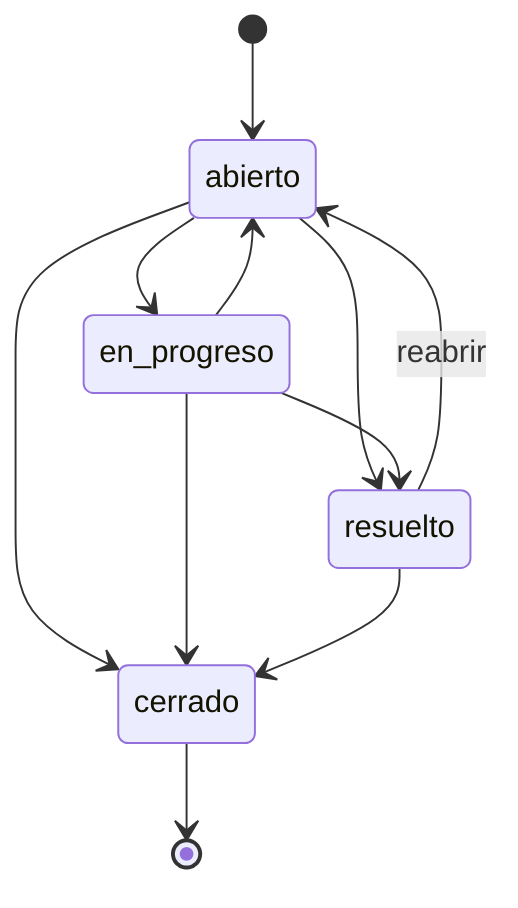

# centribal-admision

Sistema de **solicitudes de soporte** (tickets) hecho con **Django 5.2**. Un cliente abre una solicitud; los agentes la asignan, cambian su estado, añaden comentarios internos y consultan el historial de cambios.

Tiene tres formas de usarlo, todas sobre los mismos datos: una **interfaz web**, una **API REST** y el **panel de administración** de Django.

---

## Arrancar

Solo necesitas **Docker**. No hace falta instalar Python.

```bash
docker compose up -d
```

Abre **http://localhost:8000**. La primera vez tarda uno o dos minutos en construir la imagen. El arranque lo deja todo listo: crea la base de datos, los usuarios de prueba y unos tickets de ejemplo.

```bash
docker compose down        # parar
```

## Usuarios de prueba

Contraseña de todos: **`agente-dev-123`**

| Usuario | Rol | Qué puede usar |
|---|---|---|
| `ana`, `luis` | Agente | Interfaz web y API |
| `sara` | Agente y supervisora (staff) | Lo mismo, y además el panel de administración |

Para abrir una solicitud no hace falta cuenta.

## Qué probar

| # | Dónde | Qué hacer |
|---|---|---|
| 1 | http://localhost:8000/nuevo/ | Abre una solicitud como cliente, sin iniciar sesión |
| 2 | http://localhost:8000/ | Entra como `ana`: lista de tickets con filtros por estado, prioridad y agente |
| 3 | Un ticket de la lista | Asígnalo, cambia su estado y comenta. Cada cambio aparece en el **historial** |
| 4 | El ticket #4 (cerrado) | No ofrece cambios: un ticket cerrado no se reabre |
| 5 | http://localhost:8000/api/ | La API en el navegador (con la sesión de agente). Desde la terminal, ver [docs/api.md](docs/api.md) |
| 6 | http://localhost:8000/admin/ | Entra como `sara`: puede editar asunto, descripción y prioridad; comentarios e historial son de solo lectura. `ana` no puede entrar |

Desde la terminal, por ejemplo:

```bash
curl -X POST http://localhost:8000/api/tickets/ -H "Content-Type: application/json" \
  -d '{"asunto": "No puedo entrar", "descripcion": "Error 500 al hacer login", "prioridad": "alta"}'
```

---

## Cómo funciona

### El ticket y sus estados

Un ticket tiene **asunto**, **descripción**, **prioridad** (`baja`, `media`, `alta`, `critica`), **estado** y, opcionalmente, un **agente** asignado.



### Reglas

- Solo se permiten las transiciones del diagrama: **un ticket cerrado no se reabre ni se reasigna**.
- Solo se puede asignar a **agentes**. Un agente es un usuario del grupo "Agentes"; ser staff solo da acceso al admin.
- Cada cambio de estado o de asignación deja una entrada en el **historial**, en la misma transacción.
- Si dos agentes cambian el mismo ticket a la vez, gana el primero y el segundo recibe un aviso (`409` en la API). Así nadie reabre por accidente un ticket que otro acaba de cerrar.
- La base de datos también rechaza datos imposibles (estado desconocido, textos vacíos), aunque alguien se salte la web y la API.

Todas las reglas están en un único sitio, [`soporte/models.py`](soporte/models.py), y las usan tanto la web como la API:

```
 Navegador (persona)                       Otros programas (app, script, integración)
        │                                                 │
   /   → views_ui.py + forms.py  (HTML)       /api/ → views.py + serializers.py  (JSON)
        └──────────────────────┬──────────────────────────┘
                     models.py: reglas de negocio
                               │
                         base de datos
```

### Estructura del código

```
manage.py
config/            configuración del proyecto: settings.py, urls.py
cuentas/           usuarios: Usuario propio y grupo "Agentes"
soporte/           la aplicación de tickets
  models.py          Ticket, Comentario, Historial y sus reglas
  views.py           API (Django REST Framework)  ·  serializers.py, urls.py, permisos.py
  views_ui.py        interfaz web                  ·  forms.py, urls_ui.py, templates/
  admin.py           panel de administración
  management/        comandos: preparar_demo, crear_agentes
  tests/             41 tests
docs/              documentación y teoría
ejercicios/        scripts de práctica de Python
```

---

## Desarrollo

```bash
docker compose run --rm shell python manage.py test     # tests
docker compose run --rm shell ruff check .              # linter
docker compose exec web python manage.py shell          # consola de Django
docker compose logs -f web                              # logs
```

La [CI](.github/workflows/ci.yml) comprueba en cada push el lint, el formato, que no falten migraciones y los tests.

Todos los comandos de Docker y la depuración con VS Code: [docs/docker.md](docs/docker.md).

## Decisiones técnicas

- **Reglas de negocio en el modelo**, compartidas por la web (forms) y la API (serializers).
- **Usuario propio** (`cuentas.Usuario`) desde el principio y **rol de agente por grupo**, separado de `is_staff`.
- **Concurrencia optimista** en los cambios de estado y de asignación, en lugar de bloqueos.
- **Restricciones en la base de datos** (`CheckConstraint`), porque `save()` no valida.
- **Auditoría inalterable**: comentarios e historial de solo lectura en el admin; los tickets no se borran.
- **Listados paginados** en la web y en la API.
- **Docker para desarrollo**: un solo comando lo deja todo listo, con recarga en vivo al guardar.

Es un **proyecto de demostración y no va a producción**: la configuración (`config/settings.py`) es solo de desarrollo y no hay nada de despliegue. La [revisión de código](docs/07-revision-y-plan.md) detalla qué se corrigió y qué se descartó a propósito por ser propio de un despliegue real (HTTPS, límite de peticiones, PostgreSQL…). Por eso la contraseña de prueba está en el código.

## Documentación

| Documento | Contenido |
|---|---|
| [docs/api.md](docs/api.md) | Referencia de la API: endpoints, ejemplos con curl, errores |
| [docs/docker.md](docs/docker.md) | Imagen, servicios, comandos y depuración |
| [docs/07-revision-y-plan.md](docs/07-revision-y-plan.md) | Revisión de código: hallazgos, qué se corrigió y qué no |
| [docs/06-django-por-dentro.md](docs/06-django-por-dentro.md) | Cómo funciona Django por dentro, con el código de este proyecto |
| [docs/01](docs/01-historia.md) a [05](docs/05-debug.md) + [ejercicios/](ejercicios/) | Ruta de aprendizaje de Python: historia, bytecode, tipado, control de flujo, debug |

## Problemas frecuentes

| Problema | Solución |
|---|---|
| `port is already allocated` | El puerto 8000 está ocupado. Para lo que lo usa, o cambia `"8000:8000"` por `"9000:8000"` en `compose.yaml` y abre http://localhost:9000 |
| La web me manda al login | Entra con `ana`, `luis` o `sara` |
| El admin no deja entrar a `ana` | Es correcto: solo `sara` es staff |
| Quiero empezar de cero | `docker compose down`, borra `db.sqlite3` y vuelve a `docker compose up -d` |
| `docker compose ps` dice `unhealthy` | Mira `docker compose logs web` para ver el error de arranque |
