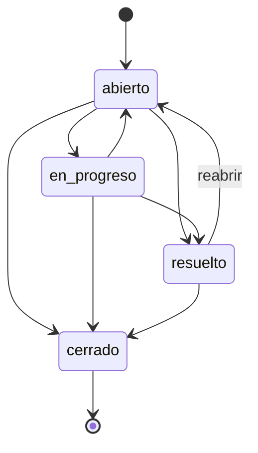

# centribal-admision

Sistema de **gestión de solicitudes de soporte** (tickets) construido dos veces para aprender Python desde los fundamentos:

1. **Fase 1, sin framework**: solo librería estándar (`http.server`, `sqlite3`, `json`, `dataclasses`, `unittest`).
2. **Fase 2, con Django**: la misma API con **Django 5.2 LTS + Django REST Framework**, y además una **interfaz web** con templates de Django y el panel de administración.

Antes de las fases hay una ruta de teoría (`docs/`) con un ejercicio ejecutable por tema (`ejercicios/`). Todo corre en **Docker**: no hace falta instalar Python en el ordenador.

---

## Índice

1. [Caso de uso](#1-caso-de-uso)
2. [Arranque rápido](#2-arranque-rápido)
3. [Entorno Docker](#3-entorno-docker)
4. [Estructura del repositorio](#4-estructura-del-repositorio)
5. [Modelo del dominio y reglas](#5-modelo-del-dominio-y-reglas)
6. [Referencia de la API](#6-referencia-de-la-api)
7. [Interfaz web (fase 2)](#7-interfaz-web-fase-2)
8. [Autenticación y agentes](#8-autenticación-y-agentes)
9. [Fase 1: sin framework](#9-fase-1-sin-framework)
10. [Fase 2: Django + DRF](#10-fase-2-django--drf)
11. [Fase 1 vs fase 2](#11-fase-1-vs-fase-2)
12. [Tests](#12-tests)
13. [Depuración](#13-depuración)
14. [Ruta de aprendizaje: docs y ejercicios](#14-ruta-de-aprendizaje-docs-y-ejercicios)
15. [Configuración (variables de entorno)](#15-configuración-variables-de-entorno)
16. [Decisiones de diseño](#16-decisiones-de-diseño)
17. [Limitaciones y siguientes pasos](#17-limitaciones-y-siguientes-pasos)
18. [Problemas frecuentes](#18-problemas-frecuentes)

---

## 1. Caso de uso

Un **cliente** abre una solicitud con **asunto**, **descripción** y **prioridad**. La solicitud nace en estado `abierto` y sin agente.

Los **agentes** (personal interno) pueden:

- listar y filtrar solicitudes;
- **asignarlas** a un agente (o quitar la asignación);
- **cambiar su estado** siguiendo un flujo con reglas;
- añadir **comentarios internos**;
- consultar el **historial de cambios**, que se registra automáticamente en cada cambio de estado o de asignación.

---

## 2. Arranque rápido

Requisitos: **Docker** con **Docker Compose v2**. Nada más.

```bash
docker compose build                       # 1. construir la imagen (una vez, o al cambiar requirements.txt)
docker compose up api-django               # 2. fase 2: aplica migraciones y arranca en :8001
```

En otra terminal:

```bash
docker compose exec api-django python manage.py crear_agentes   # 3. crea agentes ana y luis + sus tokens
```

Abre en el navegador:

| URL | Qué es |
|---|---|
| http://localhost:8001/ui/nuevo/ | Formulario público para crear una solicitud |
| http://localhost:8001/ui/ | Interfaz de agentes (usuario `ana` o `luis`, contraseña `agente-dev-123`) |
| http://localhost:8001/tickets/ | API navegable de DRF |
| http://localhost:8001/admin/ | Panel de administración (requiere superusuario, ver [§10](#10-fase-2-django--drf)) |

Para la fase 1:

```bash
docker compose up api-stdlib               # http://localhost:8000/tickets/ (solo JSON)
curl -H 'X-Agente: ana' http://localhost:8000/tickets/
```

Para parar todo: `docker compose down`.

> La contraseña `agente-dev-123` solo existe para el entorno local. Está en
> [`crear_agentes.py`](fase2_django/soporte/management/commands/crear_agentes.py).

---

## 3. Entorno Docker

- **Imagen**: `python:3.13-slim` (Debian slim oficial). Python 3.13 y no 3.14 porque Django 5.2 LTS la soporta oficialmente.
- **Volumen**: el proyecto se monta en `/app` dentro del contenedor, así que los cambios en el código se ven al instante, sin reconstruir.
- **Dependencias** ([`requirements.txt`](requirements.txt)): `Django`, `djangorestframework`, `django-filter`, `debugpy`, `mypy`.

### Servicios ([`compose.yaml`](compose.yaml))

| Servicio | Puerto | Para qué |
|---|---|---|
| `shell` | 5678 (debugpy) | Terminal para ejercicios, tests y depuración |
| `api-stdlib` | 8000 | Fase 1: `python servidor.py` |
| `api-django` | 8001 | Fase 2: `migrate` + `runserver` (recarga sola al guardar) |

### Comandos útiles

```bash
docker compose run --rm shell                         # terminal interactiva dentro del contenedor
docker compose run --rm --service-ports shell         # igual, publicando el 5678 para VS Code
docker compose run --rm shell python --version        # un comando suelto
docker compose up -d api-stdlib api-django            # las dos APIs en segundo plano
docker compose logs -f api-django                     # ver logs
docker compose exec api-django python manage.py shell # consola de Django con el servidor en marcha
docker compose down                                   # parar y borrar contenedores
docker compose down --rmi local                       # además borra la imagen: empezar de cero
```

---

## 4. Estructura del repositorio

```
centribal-admision/
├── Dockerfile, compose.yaml, requirements.txt
├── .vscode/launch.json            # "Attach to Docker" (debugpy, puerto 5678)
├── PLAN.md                        # plan de trabajo por pasos
├── docs/                          # teoría
│   ├── 01-historia.md
│   ├── 02-interpretado-o-compilado.md
│   ├── 03-tipado.md
│   ├── 04-estructuras-de-control.md
│   ├── 05-debug.md
│   └── 06-django-por-dentro.md
├── ejercicios/                    # un script por tema
│   ├── 02_bytecode.py  03_tipado.py  04_control.py  05_debug.py (bug intencional)
├── fase1_sin_framework/
│   ├── dominio.py                 # dataclasses, enums y reglas de negocio
│   ├── repositorio.py             # sqlite3: esquema, consultas, transacciones
│   ├── servidor.py                # http.server: enrutado, JSON, errores, auth
│   └── tests/                     # unittest: dominio, repositorio y servidor real
└── fase2_django/
    ├── manage.py
    ├── config/                    # settings.py, urls.py (proyecto)
    └── soporte/                   # app
        ├── models.py              # Ticket, Comentario, Historial + reglas
        ├── serializers.py, views.py, urls.py          # API (DRF)
        ├── forms.py, views_ui.py, urls_ui.py, templates/   # UI (HTML)
        ├── admin.py               # panel de administración
        ├── management/commands/crear_agentes.py
        ├── migrations/
        └── tests/                 # test_api.py, test_ui.py
```

Cada fase tiene su propio README con más detalle: [fase 1](fase1_sin_framework/README.md) · [fase 2](fase2_django/README.md).

---

## 5. Modelo del dominio y reglas

Es el mismo en las dos fases.

### Entidades

**Ticket**

| Campo | Tipo | Notas |
|---|---|---|
| `id` | entero | autogenerado |
| `asunto` | texto (máx. 200) | obligatorio, no puede estar vacío |
| `descripcion` | texto | obligatorio |
| `prioridad` | `baja` · `media` · `alta` · `critica` | por defecto `media` |
| `estado` | `abierto` · `en_progreso` · `resuelto` · `cerrado` | nace `abierto`; solo cambia por su endpoint |
| `agente` | agente o `null` | solo cambia por su endpoint |
| `creado`, `actualizado` | fecha/hora (UTC) | automáticos |

**Comentario**: `ticket`, `autor` (agente), `texto`, `es_interno` (siempre `true`) y `fecha`.

**Historial**: `ticket`, `campo` (`estado` o `agente`), `valor_anterior`, `valor_nuevo`, `autor` y `fecha`.

### Flujo de estados



### Reglas de negocio

1. Solo se permiten las transiciones del diagrama. **Un ticket `cerrado` no se reabre.**
2. No se puede "cambiar" al mismo estado en el que ya está.
3. Un ticket `cerrado` **no se puede reasignar**.
4. No se puede asignar al agente que ya tiene (tampoco "desasignar" uno que no tiene agente).
5. Solo se puede asignar a **agentes** existentes.
6. Cada cambio de estado o de asignación crea una entrada de **historial en la misma transacción**: o se guardan los dos, o ninguno.
7. Crear un ticket ignora cualquier `estado` o `agente` que mande el cliente.

Dónde viven las reglas:
- Fase 1: [`dominio.py`](fase1_sin_framework/dominio.py) (`TRANSICIONES`, `Ticket.cambiar_estado`, `Ticket.asignar`).
- Fase 2: [`models.py`](fase2_django/soporte/models.py) (`validar_estado`, `validar_asignacion`, `cambiar_estado`, `asignar`).

---

## 6. Referencia de la API

Las dos fases exponen **las mismas rutas**. La fase 1 está en el puerto `8000` y la fase 2 en el `8001`.

| Método | Ruta | Acción | Acceso |
|---|---|---|---|
| `POST` | `/tickets/` | Crear solicitud | Público |
| `GET` | `/tickets/` | Listar | Agente |
| `GET` | `/tickets/{id}/` | Detalle | Agente |
| `PATCH` | `/tickets/{id}/estado/` | Cambiar estado (+ historial) | Agente |
| `PATCH` | `/tickets/{id}/asignar/` | Asignar o desasignar (+ historial) | Agente |
| `POST` | `/tickets/{id}/comentarios/` | Añadir comentario interno | Agente |
| `GET` | `/tickets/{id}/comentarios/` | Listar comentarios | Agente |
| `GET` | `/tickets/{id}/historial/` | Ver historial | Agente |

**Filtros del listado**: `?estado=abierto`, `?prioridad=alta`, y solo en la fase 2 `?agente__username=luis`. Se pueden combinar.

### Ejemplos

En la fase 2 hay que mandar `Content-Type: application/json`. Los ejemplos usan la autenticación de la fase 2; en la fase 1 se cambia la cabecera `Authorization` por `X-Agente: ana` ([§8](#8-autenticación-y-agentes)).

```bash
B=http://localhost:8001
J="Content-Type: application/json"
T="Authorization: Token <token de ana>"     # lo imprime: manage.py crear_agentes
```

**Crear una solicitud** (público) → `201 Created`

```bash
curl -X POST $B/tickets/ -H "$J" \
  -d '{"asunto": "No puedo entrar", "descripcion": "Error 500 al hacer login", "prioridad": "alta"}'
```

```json
{
  "id": 1,
  "asunto": "No puedo entrar",
  "descripcion": "Error 500 al hacer login",
  "prioridad": "alta",
  "estado": "abierto",
  "agente": null,
  "creado": "2026-10-02T20:26:11.413651Z",
  "actualizado": "2026-10-02T20:26:11.413674Z"
}
```

**Listar con filtros** → `200 OK` (array de tickets)

```bash
curl "$B/tickets/?estado=abierto&prioridad=alta" -H "$T"
```

**Asignar** (`null` para desasignar) → `200 OK` con el ticket actualizado

```bash
curl -X PATCH $B/tickets/1/asignar/ -H "$T" -H "$J" -d '{"agente": "luis"}'
```

**Cambiar estado** → `200 OK` con el ticket actualizado

```bash
curl -X PATCH $B/tickets/1/estado/ -H "$T" -H "$J" -d '{"estado": "en_progreso"}'
```

**Comentar** → `201 Created`

```bash
curl -X POST $B/tickets/1/comentarios/ -H "$T" -H "$J" -d '{"texto": "Reproducido en staging"}'
```

```json
{"id": 1, "autor": "ana", "texto": "Reproducido en staging", "es_interno": true, "fecha": "2026-10-02T20:26:11.467109Z"}
```

**Historial** → `200 OK`

```bash
curl $B/tickets/1/historial/ -H "$T"
```

```json
[
  {"id": 1, "campo": "agente", "valor_anterior": null,      "valor_nuevo": "luis",        "autor": "ana", "fecha": "..."},
  {"id": 2, "campo": "estado", "valor_anterior": "abierto", "valor_nuevo": "en_progreso", "autor": "ana", "fecha": "..."}
]
```

### Códigos de respuesta y errores

| Código | Cuándo |
|---|---|
| `200` / `201` | Correcto / creado |
| `400` | Datos inválidos o regla de negocio incumplida (transición no permitida, ticket cerrado…) |
| `401` | No hay credenciales |
| `403` | Hay credenciales, pero el usuario no es agente |
| `404` | El ticket o la ruta no existen |
| `405` | Método no permitido en esa ruta (p. ej. `DELETE /tickets/1/`) |

Cada fase devuelve los errores con un formato distinto:

```jsonc
// Fase 1: siempre una clave "error"
{"error": "estado inválido: 'pausado'. Valores válidos: abierto, en_progreso, resuelto, cerrado"}

// Fase 2 (DRF): errores por campo, de reglas generales o de autenticación
{"estado": ["\"pausado\" no es una elección válida."]}
{"non_field_errors": ["El ticket ya está asignado a ese agente."]}
{"detail": "Las credenciales de autenticación no se proveyeron."}
```

---

## 7. Interfaz web (fase 2)

Está hecha con **templates de Django** (HTML generado en el servidor), sin JavaScript ni librerías externas, con tema claro/oscuro automático.

| Ruta | Página | Acceso |
|---|---|---|
| `/ui/nuevo/` | Formulario para abrir una solicitud | Público |
| `/ui/` | Lista con filtros por estado, prioridad, "asignados a mí" y "sin asignar" | Agente |
| `/ui/tickets/<id>/` | Detalle: cambio de estado (solo muestra transiciones válidas), asignación, comentarios e historial | Agente |
| `/cuentas/login/` | Login de agentes | Público |

Las acciones siguen el patrón **POST → redirect → GET**: si recargas la página, la acción no se repite. Si un formulario tiene errores, la página se vuelve a pintar con el mensaje.

### ¿UI y API a la vez? Sí: comparten el modelo

```
   Navegador (persona)                   App móvil / frontend JS / otro sistema
          │                                            │
   /ui/  → views_ui.py + forms.py             /tickets/ → views.py + serializers.py (DRF)
          devuelve HTML                                devuelve JSON
          └───────────────────────┬────────────────────┘
               models.py: validar_estado(), validar_asignacion(), cambiar_estado(), asignar()
                                  │
                            base de datos
```

- La **UI** es para personas. La **API** es para programas: un widget de chat que abre tickets, un sistema de monitorización que crea uno crítico cuando cae un servidor, una app móvil, o una UI futura hecha en React.
- Las reglas se escriben **una sola vez** en el modelo. Los forms y los serializers solo las llaman, así que un cambio hecho por la UI aparece en la API y al revés.

---

## 8. Autenticación y agentes

| | Fase 1 | Fase 2 |
|---|---|---|
| Qué es un agente | Un nombre en la tabla `agentes` (`ana`, `luis`, se crean al arrancar) | Un `User` de Django con `is_staff=True` |
| Cómo se identifica | Cabecera `X-Agente: ana` (sin contraseña) | API: `Authorization: Token <clave>` o sesión. UI: login con usuario y contraseña |
| Obtener credenciales | — | `manage.py crear_agentes` (imprime los tokens) o `POST /token/` con `username` y `password` |

```bash
curl -X POST http://localhost:8001/token/ -d 'username=ana&password=agente-dev-123'
# {"token": "2ef8b3..."}
```

La autenticación de la fase 1 es **didáctica, no segura**: cualquiera puede mandar la cabecera.

---

## 9. Fase 1: sin framework

Tres capas que solo conocen la de debajo:

```
servidor.py   (HTTP: rutas por regex, JSON, códigos de estado, cabecera X-Agente)
     │
repositorio.py (SQL: esquema, consultas, transacciones; filas ↔ dataclasses)
     │
dominio.py    (reglas puras: dataclasses, enums, transiciones; sin HTTP ni SQL)
```

- El dominio lanza `ErrorValidacion` / `TransicionInvalida`, el repositorio `NoEncontrado`, y el servidor las traduce a `400` / `404`.
- `ThreadingHTTPServer` atiende cada petición en un hilo, con una conexión SQLite por operación.
- La base de datos es `fase1_sin_framework/soporte.sqlite3` (se crea sola).

Más detalle en el [README de la fase 1](fase1_sin_framework/README.md).

---

## 10. Fase 2: Django + DRF

| Pieza | Archivo | Papel |
|---|---|---|
| Modelos | `soporte/models.py` | Tablas (vía migraciones) y reglas de negocio |
| Serializers | `soporte/serializers.py` | JSON ↔ modelo, validación de la API |
| ViewSet | `soporte/views.py` | `TicketViewSet` con `@action` para `estado`, `asignar`, `comentarios` e `historial` |
| Router | `soporte/urls.py` | `DefaultRouter` genera las rutas de la API |
| Forms + vistas UI | `soporte/forms.py`, `views_ui.py`, `urls_ui.py`, `templates/` | Interfaz HTML |
| Admin | `soporte/admin.py` | Tickets con comentarios e historial en línea; estado y agente en solo lectura |
| Comando | `soporte/management/commands/crear_agentes.py` | Agentes de prueba + tokens |

### Tareas habituales

```bash
docker compose exec api-django python manage.py crear_agentes      # agentes de prueba
docker compose exec api-django python manage.py createsuperuser    # usuario para /admin/
docker compose exec api-django python manage.py makemigrations     # tras cambiar models.py
docker compose exec api-django python manage.py migrate            # aplicar migraciones
docker compose exec api-django python manage.py shell              # consola con los modelos cargados
```

Los agentes `ana` y `luis` pueden entrar a `/admin/`, pero no tienen permisos sobre los modelos. Para ver el panel completo crea un superusuario.

La base de datos es `fase2_django/db.sqlite3`. Más detalle en el [README de la fase 2](fase2_django/README.md).

---

## 11. Fase 1 vs fase 2

| Tarea | Fase 1 (a mano) | Fase 2 (Django + DRF) |
|---|---|---|
| Rutas | Lista de regex y un bucle | `DefaultRouter` + `@action` |
| Esquema de BD | `CREATE TABLE` en un string | Modelos → migraciones versionadas |
| Consultas | SQL escrito a mano | ORM (`ticket.historial.create(...)`) |
| Validación | Funciones propias | Serializers y forms, derivados del modelo |
| Errores HTTP | `try/except` que traduce cada excepción | Automáticos, con detalle por campo |
| Autenticación | Cabecera sin contraseña | Usuarios, contraseñas, sesiones, tokens, permisos |
| Filtros | `if` que arman el SQL | `filterset_fields` |
| Interfaz | No hay | Templates + admin |
| Tests | Servidor real en un hilo + `urllib` | `APITestCase` / `TestCase` con BD de test automática |
| Líneas propias (API) | ≈ 470 | ≈ 290 (haciendo más) |

**Lo que cuesta Django**: más conceptos que aprender, más "magia" que entender para depurar y dependencias externas que mantener. La fase 1 sirve para ver qué hace esa magia por debajo.

---

## 12. Tests

```bash
# Fase 1: 25 tests (dominio, repositorio y servidor HTTP real)
docker compose run --rm -w /app/fase1_sin_framework shell python -m unittest discover -s tests -v

# Fase 2: 20 tests (12 de API + 8 de UI)
docker compose run --rm -w /app/fase2_django shell python manage.py test -v 2

# Un solo test
docker compose run --rm -w /app/fase2_django shell python manage.py test soporte.tests.test_api.TicketApiTest.test_flujo_completo
```

Qué se cubre: valores por defecto y validación al crear, permisos (401/403), filtros, el flujo completo (asignar → estado → comentar → historial), transiciones prohibidas sin efectos secundarios, desasignar, métodos no permitidos y JSON mal formado.

---

## 13. Depuración

Resumen de [`docs/05-debug.md`](docs/05-debug.md):

- **`breakpoint()` + pdb**: pon `breakpoint()` en el código y ejecútalo con una terminal interactiva (`docker compose run --rm shell ...`, sin `-T`). Comandos básicos: `n`, `s`, `c`, `p variable`, `q`.
- **VS Code**: arranca el programa esperando al debugger y conecta con **"Attach to Docker"** ([`.vscode/launch.json`](.vscode/launch.json)):

  ```bash
  docker compose run --rm --service-ports shell \
    python -Xfrozen_modules=off -m debugpy --listen 0.0.0.0:5678 --wait-for-client ejercicios/05_debug.py
  ```

  Para depurar Django, cambia el script por `fase2_django/manage.py runserver 0.0.0.0:8001 --noreload` (con `-p 8001:8001`).

---

## 14. Ruta de aprendizaje: docs y ejercicios

| # | Tema | Teoría | Práctica |
|---|---|---|---|
| 1 | Historia y filosofía de Python | [01-historia.md](docs/01-historia.md) | — |
| 2 | ¿Interpretado o compilado? Bytecode, PVM, `__pycache__` | [02-interpretado-o-compilado.md](docs/02-interpretado-o-compilado.md) | `02_bytecode.py` |
| 3 | Tipado dinámico y fuerte, duck typing, type hints, mypy | [03-tipado.md](docs/03-tipado.md) | `03_tipado.py` |
| 4 | `if`, `match`, bucles, excepciones, comprehensions | [04-estructuras-de-control.md](docs/04-estructuras-de-control.md) | `04_control.py` |
| 5 | Debug: logging, pdb, debugpy + VS Code | [05-debug.md](docs/05-debug.md) | `05_debug.py` (con un bug para encontrar) |
| 6 | Django por dentro: petición, rutas, ORM, validación, patrones | [06-django-por-dentro.md](docs/06-django-por-dentro.md) | `manage.py shell` |
| 7 | API sin framework | [fase 1](fase1_sin_framework/README.md) | `fase1_sin_framework/` |
| 8 | Django + DRF + templates | [fase 2](fase2_django/README.md) | `fase2_django/` |

```bash
docker compose run --rm shell python ejercicios/02_bytecode.py
docker compose run --rm shell mypy ejercicios/03_tipado.py
```

---

## 15. Configuración (variables de entorno)

| Variable | Fase | Por defecto | Para qué |
|---|---|---|---|
| `DB_PATH` | 1 | `soporte.sqlite3` | Ruta de la base de datos |
| `DJANGO_SECRET_KEY` | 2 | valor inseguro de desarrollo | Clave criptográfica (obligatorio cambiarla en producción) |
| `DJANGO_DEBUG` | 2 | `1` | `0` desactiva el modo debug |
| `DJANGO_ALLOWED_HOSTS` | 2 | `*` si hay debug | Dominios permitidos, separados por comas, cuando `DJANGO_DEBUG=0` |
| `DJANGO_DB_PATH` | 2 | `fase2_django/db.sqlite3` | Ruta de la base de datos |

---

## 16. Decisiones de diseño

- **Docker en vez de instalar Python**: el sistema no se toca y cualquiera reproduce el mismo entorno.
- **Mismo dominio en las dos fases**: así se ve qué aporta el framework sin que cambien las reglas.
- **Las reglas no dependen de la interfaz**: en la fase 1 el dominio no sabe de HTTP ni de SQL y se prueba aislado. En la fase 2 las reglas viven en el modelo y las usan tanto la API como la UI.
- **Estado y agente no se editan directamente**: solo por sus endpoints o acciones, que validan y dejan historial. Por eso son de solo lectura en el serializer y en el admin.
- **Historial en la misma transacción que el cambio**: nunca hay un cambio sin rastro ni un rastro sin cambio.
- **Agente = `User` con `is_staff`** en Django: reutiliza usuarios, contraseñas, permisos y admin en lugar de crear un modelo propio.
- **Token primero en la autenticación de DRF**: así un anónimo recibe `401` (con cabecera `WWW-Authenticate`) y no `403`.
- **SQLite** en las dos fases: sin servidor de base de datos aparte. En la fase 2, pasar a PostgreSQL solo exige cambiar `DATABASES`.

---

## 17. Limitaciones y siguientes pasos

- La autenticación de la fase 1 no es segura (es didáctica).
- No hay paginación en los listados (en DRF se activa con `DEFAULT_PAGINATION_CLASS`).
- El cliente no tiene cuenta: no puede consultar sus propias solicitudes después de crearlas.
- No hay notificaciones (email al asignar, etc.).
- `runserver` es solo para desarrollo. En producción haría falta gunicorn, PostgreSQL, `DJANGO_DEBUG=0` y servir los estáticos (`collectstatic`).
- Posibles mejoras: paginación, búsqueda por texto, documentación OpenAPI (`drf-spectacular`), CI con los tests y un frontend que consuma la API.

---

## 18. Problemas frecuentes

| Síntoma | Solución |
|---|---|
| `port is already allocated` | Otro proceso usa el 8000, 8001 o 5678. Páralo, o cambia el puerto de la izquierda en `compose.yaml` (`"9001:8001"`) |
| `401` en la API | Falta la cabecera: `X-Agente` en la fase 1, `Authorization: Token ...` en la fase 2 |
| `403` en la API | El usuario existe pero no es agente (`is_staff`) |
| `no such table` en Django | Faltan migraciones: `python manage.py migrate` (el servicio `api-django` las aplica al arrancar) |
| `/admin/` dice que no tienes permisos | Entra con un superusuario (`createsuperuser`) |
| Empezar con datos limpios | Borra `fase1_sin_framework/soporte.sqlite3` y/o `fase2_django/db.sqlite3` y vuelve a arrancar |
| Cambié `requirements.txt` y no se nota | `docker compose build` |
| pdb no responde | Ejecuta sin `-T`: necesita una terminal interactiva |
