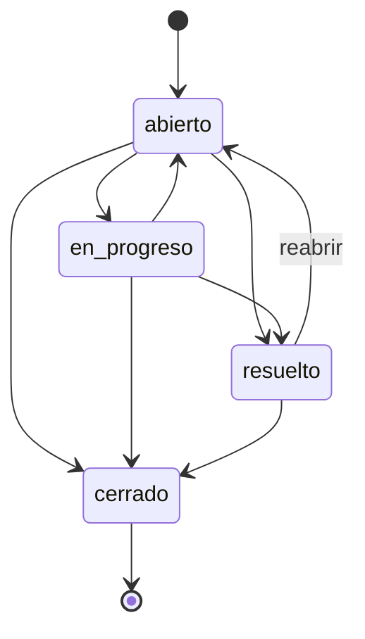

# centribal-admision

Sistema de **gestión de solicitudes de soporte** (tickets) hecho con **Django 5.2 LTS**. Tiene tres caras sobre los mismos datos:

- una **API REST** con Django REST Framework, para que la usen otros programas;
- una **interfaz web** con templates de Django, para clientes y agentes;
- el **panel de administración** de Django.

El repositorio incluye además una ruta de aprendizaje de Python (`docs/` + `ejercicios/`). Todo corre en **Docker**: no hace falta instalar Python en el ordenador.

---

## Índice

1. [Caso de uso](#1-caso-de-uso)
2. [Arranque rápido](#2-arranque-rápido)
3. [Entorno Docker](#3-entorno-docker)
4. [Estructura del repositorio](#4-estructura-del-repositorio)
5. [Modelo del dominio y reglas](#5-modelo-del-dominio-y-reglas)
6. [Referencia de la API](#6-referencia-de-la-api)
7. [Interfaz web](#7-interfaz-web)
8. [Autenticación y agentes](#8-autenticación-y-agentes)
9. [Cómo está organizado el código Django](#9-cómo-está-organizado-el-código-django)
10. [Tests](#10-tests)
11. [Depuración](#11-depuración)
12. [Ruta de aprendizaje: docs y ejercicios](#12-ruta-de-aprendizaje-docs-y-ejercicios)
13. [Configuración (variables de entorno)](#13-configuración-variables-de-entorno)
14. [Decisiones de diseño](#14-decisiones-de-diseño)
15. [Limitaciones y siguientes pasos](#15-limitaciones-y-siguientes-pasos)
16. [Problemas frecuentes](#16-problemas-frecuentes)

---

## 1. Caso de uso

Un **cliente** abre una solicitud con **asunto**, **descripción** y **prioridad**. La solicitud nace en estado `abierto` y sin agente.

Los **agentes** (personal interno) pueden:

- listar y filtrar solicitudes;
- **asignarlas** a un agente (o quitar la asignación);
- **cambiar su estado** siguiendo un flujo con reglas;
- añadir **comentarios internos**;
- consultar el **historial de cambios**, que se registra automáticamente en cada cambio de estado o de asignación.

---

## 2. Arranque rápido

Requisitos: **Docker** con **Docker Compose v2**. Nada más.

```bash
docker compose up -d                                         # construye, migra y arranca en :8000
docker compose exec web python manage.py crear_agentes       # crea ana, luis y sara + sus tokens
```

| URL | Qué es |
|---|---|
| http://localhost:8000/nuevo/ | Formulario público para crear una solicitud |
| http://localhost:8000/ | Interfaz de agentes (usuario `ana`, `luis` o `sara`, contraseña `agente-dev-123`) |
| http://localhost:8000/api/ | API navegable de DRF (los tickets en `/api/tickets/`) |
| http://localhost:8000/admin/ | Panel de administración (usuario `sara`, misma contraseña) |

Para parar: `docker compose down`.

> La contraseña `agente-dev-123` solo existe para el entorno local. Está en
> [`crear_agentes.py`](soporte/management/commands/crear_agentes.py).

---

## 3. Entorno Docker

### Imagen ([`Dockerfile`](Dockerfile)): una receta, dos destinos

Es un Dockerfile **multi-stage**: varias etapas en un solo archivo, y cada servicio elige con `target` hasta dónde construir.

```
base  python:3.13-slim + usuario "app" (sin privilegios) + requirements.txt
 ├── dev   + requirements-dev.txt (debugpy, mypy). El código llega por volumen → recarga en vivo
 └── prod  + código copiado + collectstatic + gunicorn + HEALTHCHECK. DEBUG=0, BD en /data
```

| | `dev` | `prod` |
|---|---|---|
| Servidor | `runserver` (recarga al guardar) | **gunicorn** con 3 workers |
| Código | Volumen `.:/app` (en vivo) | Copiado dentro de la imagen |
| Estáticos | Los sirve Django (con DEBUG) | `collectstatic` + **WhiteNoise** |
| `DEBUG` | Activado | Desactivado (errores 404/500 sin detalles internos) |
| Base de datos | `db.sqlite3` del proyecto | Volumen con nombre `datos-prod` (`/data/db.sqlite3`) |
| Tamaño aprox. | ~310 MB | ~200 MB |

Buenas prácticas aplicadas:
- **Usuario sin privilegios** (`app`, UID 1000): si alguien explotara la aplicación, no sería root dentro del contenedor.
- **Orden de capas para la caché**: primero `requirements.txt` y luego el código. Cambiar código no reinstala dependencias.
- **Cache mount de pip** (`RUN --mount=type=cache`): reconstruir tras cambiar `requirements.txt` no vuelve a descargar todo.
- **`.dockerignore`**: ni `.git`, ni `.env`, ni la base de datos entran en la imagen.
- **Healthcheck** contra `/salud/`: Docker sabe si la aplicación responde, no solo si el proceso existe (`docker compose ps` muestra `healthy`).
- **`exec gunicorn`**: gunicorn pasa a ser el proceso principal y recibe las señales de parada de Docker (cierre limpio).

### Dependencias

| Archivo | Contenido | Dónde se instala |
|---|---|---|
| [`requirements.txt`](requirements.txt) | Django 5.2 LTS, DRF, django-filter, gunicorn, whitenoise | `dev` y `prod` |
| [`requirements-dev.txt`](requirements-dev.txt) | `-r requirements.txt` + debugpy, mypy | Solo `dev` |

Las versiones tienen límite superior (`<5.3`, `<4`…), para que una versión mayor nueva no rompa el proyecto sin avisar.

### Servicios ([`compose.yaml`](compose.yaml))

| Servicio | Puerto | Arranca con | Para qué |
|---|---|---|---|
| `web` | 8000 | `docker compose up -d` | Desarrollo: `migrate` + `runserver`, healthcheck, se reinicia solo si cae |
| `shell` | 5678 (debugpy) | `docker compose run --rm shell` | Terminal para tests, ejercicios, `manage.py` y depuración |
| `prod` | 8001 | `docker compose --profile prod up -d prod` | La imagen de producción funcionando en local |

`shell` y `prod` están en **perfiles** (`tools`, `prod`), así que `docker compose up` no los arranca. Las variables de desarrollo se pueden cambiar copiando [`.env.example`](.env.example) a `.env`; Compose lo lee solo y git lo ignora.

### Comandos útiles

```bash
docker compose up -d                                   # arrancar desarrollo en segundo plano
docker compose watch                                   # igual, y reconstruye solo al cambiar requirements*.txt
docker compose ps                                      # estado (healthy / unhealthy)
docker compose logs -f web                             # ver logs
docker compose exec web python manage.py shell         # consola de Django con los modelos cargados
docker compose run --rm shell                          # terminal en un contenedor nuevo
docker compose run --rm shell python manage.py test    # un comando suelto
docker compose run --rm --service-ports shell          # terminal publicando el 5678 para VS Code
docker compose build                                   # reconstruir la imagen de desarrollo

docker compose --profile prod up -d --build prod       # producción en local → http://localhost:8001
docker compose --profile prod exec prod python manage.py check --deploy   # revisión de seguridad
docker compose --profile prod down                     # parar todo, incluido prod

docker compose down --rmi local -v                     # borrar contenedores, imágenes y volúmenes: empezar de cero
```

---

## 4. Estructura del repositorio

```
centribal-admision/
├── manage.py                      # puerta de entrada de los comandos de Django
├── config/                        # el PROYECTO Django
│   ├── settings.py                # configuración global
│   ├── urls.py                    # rutas raíz
│   └── wsgi.py, asgi.py           # puntos de entrada para servidores
├── cuentas/                       # APP de usuarios: Usuario(AbstractUser) + grupo "Agentes"
├── soporte/                       # APP de tickets
│   ├── models.py                  # Ticket, Comentario, Historial + reglas de negocio
│   ├── serializers.py, views.py, urls.py          # API (DRF)
│   ├── forms.py, views_ui.py, urls_ui.py          # interfaz web
│   ├── permisos.py                # EsAgente (permiso de DRF)
│   ├── templates/                 # HTML (soporte/*.html, registration/login.html)
│   ├── admin.py                   # panel de administración
│   ├── management/commands/crear_agentes.py
│   ├── migrations/                # historial del esquema de la BD
│   └── tests/                     # test_api, test_ui, test_modelo, test_admin
├── docs/                          # teoría de Python y de Django
├── ejercicios/                    # un script por tema
├── Dockerfile                     # multi-stage: dev y prod
├── compose.yaml                   # servicios web, shell y prod
├── requirements.txt               # dependencias de ejecución
├── requirements-dev.txt           # + herramientas de desarrollo (debugpy, mypy, ruff)
├── pyproject.toml                 # configuración de Ruff
├── .github/workflows/ci.yml       # CI: lint, formato, migraciones, tests, build
├── .env.example                   # plantilla de variables (copiar a .env)
├── .vscode/launch.json            # "Attach to Docker" (debugpy, puerto 5678)
└── PLAN.md                        # plan original de trabajo
```

---

## 5. Modelo del dominio y reglas

### Entidades

**Ticket**

| Campo | Tipo | Notas |
|---|---|---|
| `id` | entero | autogenerado |
| `asunto` | texto (máx. 200) | obligatorio, no puede estar vacío |
| `descripcion` | texto (máx. 5000) | obligatorio |
| `prioridad` | `baja` · `media` · `alta` · `critica` | por defecto `media` |
| `estado` | `abierto` · `en_progreso` · `resuelto` · `cerrado` | nace `abierto`; solo cambia por su acción |
| `agente` | usuario agente o `null` | solo cambia por su acción; un agente con tickets no se puede borrar (se desactiva) |
| `creado`, `actualizado` | fecha/hora (UTC) | automáticos |

**Comentario**: `ticket`, `autor` (agente), `texto` (máx. 2000) y `fecha`. Todos son internos: solo los ven los agentes.

**Historial**: `ticket`, `campo` (`estado` o `agente`), `valor_anterior`, `valor_nuevo`, `autor` y `fecha`.

### Flujo de estados



### Reglas de negocio

1. Solo se permiten las transiciones del diagrama. **Un ticket `cerrado` no se reabre.**
2. No se puede "cambiar" al mismo estado en el que ya está.
3. Un ticket `cerrado` **no se puede reasignar**.
4. No se puede asignar al agente que ya tiene (tampoco "desasignar" uno que no tiene agente).
5. Solo se puede asignar a **agentes** (usuarios activos del grupo "Agentes").
6. Cada cambio de estado o de asignación crea una entrada de **historial en la misma transacción**: o se guardan los dos, o ninguno.
7. Crear un ticket ignora cualquier `estado` o `agente` que mande el cliente.
8. **Concurrencia**: si dos peticiones cambian el mismo ticket a la vez, gana la primera y la segunda recibe un conflicto (`409`). Así no se puede, por ejemplo, reabrir un ticket que otro agente acaba de cerrar.
9. La **base de datos** también rechaza datos imposibles (estado o prioridad desconocidos, textos vacíos) con `CheckConstraint`, aunque alguien se salte la API y la web.

Las reglas están en [`soporte/models.py`](soporte/models.py) (`validar_estado`, `validar_asignacion`, `cambiar_estado`, `asignar`). Las usan tanto la API como la interfaz web.

---

## 6. Referencia de la API

| Método | Ruta | Acción | Acceso |
|---|---|---|---|
| `POST` | `/api/tickets/` | Crear solicitud | Público |
| `GET` | `/api/tickets/` | Listar | Agente |
| `GET` | `/api/tickets/{id}/` | Detalle | Agente |
| `PATCH` | `/api/tickets/{id}/estado/` | Cambiar estado (+ historial) | Agente |
| `PATCH` | `/api/tickets/{id}/asignar/` | Asignar o desasignar (+ historial) | Agente |
| `POST` | `/api/tickets/{id}/comentarios/` | Añadir comentario interno | Agente |
| `GET` | `/api/tickets/{id}/comentarios/` | Listar comentarios | Agente |
| `GET` | `/api/tickets/{id}/historial/` | Ver historial | Agente |
| `POST` | `/api/token/` | Obtener token con `username` y `password` | Público |

**Filtros del listado**: `?estado=abierto`, `?prioridad=alta`, `?agente__username=luis`. Se pueden combinar.

### Ejemplos

```bash
B=http://localhost:8000/api
J="Content-Type: application/json"
T="Authorization: Token <token de ana>"     # lo imprime: manage.py crear_agentes
```

**Crear una solicitud** (público) → `201 Created`

```bash
curl -X POST $B/tickets/ -H "$J" \
  -d '{"asunto": "No puedo entrar", "descripcion": "Error 500 al hacer login", "prioridad": "alta"}'
```

```json
{
  "id": 1,
  "asunto": "No puedo entrar",
  "descripcion": "Error 500 al hacer login",
  "prioridad": "alta",
  "estado": "abierto",
  "agente": null,
  "creado": "2026-10-02T20:26:11.413651Z",
  "actualizado": "2026-10-02T20:26:11.413674Z"
}
```

**Listar con filtros** → `200 OK`, **paginado** (20 por página; `?page=2` para la siguiente)

```bash
curl "$B/tickets/?estado=abierto&prioridad=alta" -H "$T"
```

```json
{"count": 42, "next": "http://localhost:8000/api/tickets/?estado=abierto&page=2&prioridad=alta", "previous": null, "results": [ ... ]}
```

**Asignar** (`null` para desasignar) → `200 OK` con el ticket actualizado

```bash
curl -X PATCH $B/tickets/1/asignar/ -H "$T" -H "$J" -d '{"agente": "luis"}'
```

**Cambiar estado** → `200 OK` con el ticket actualizado

```bash
curl -X PATCH $B/tickets/1/estado/ -H "$T" -H "$J" -d '{"estado": "en_progreso"}'
```

**Comentar** → `201 Created`

```bash
curl -X POST $B/tickets/1/comentarios/ -H "$T" -H "$J" -d '{"texto": "Reproducido en staging"}'
```

```json
{"id": 1, "autor": "ana", "texto": "Reproducido en staging", "fecha": "2026-10-02T20:26:11.467109Z"}
```

**Historial** → `200 OK` (paginado igual que comentarios y el listado)

```bash
curl $B/tickets/1/historial/ -H "$T"
```

```json
{"count": 2, "next": null, "previous": null, "results": [
  {"id": 1, "campo": "agente", "valor_anterior": null,      "valor_nuevo": "luis",        "autor": "ana", "fecha": "..."},
  {"id": 2, "campo": "estado", "valor_anterior": "abierto", "valor_nuevo": "en_progreso", "autor": "ana", "fecha": "..."}
]}
```

### Códigos de respuesta y errores

| Código | Cuándo |
|---|---|
| `200` / `201` | Correcto / creado |
| `400` | Datos inválidos o regla de negocio incumplida (transición no permitida, ticket cerrado…) |
| `401` | No hay credenciales |
| `403` | Hay credenciales, pero el usuario no es agente |
| `404` | El ticket no existe |
| `405` | Método no permitido (p. ej. `DELETE /api/tickets/1/`) |
| `409` | Conflicto: otra petición cambió el ticket mientras tanto; hay que recargar y reintentar |

Los errores vienen en el formato de DRF:

```jsonc
{"estado": ["\"pausado\" no es una elección válida."]}                 // error de un campo
{"non_field_errors": ["El ticket ya está asignado a ese agente."]}     // regla general
{"detail": "Las credenciales de autenticación no se proveyeron."}     // autenticación / permisos
```

---

## 7. Interfaz web

Está hecha con **templates de Django** (HTML generado en el servidor), sin JavaScript ni librerías externas, con tema claro/oscuro automático.

| Ruta | Página | Acceso |
|---|---|---|
| `/nuevo/` | Formulario para abrir una solicitud | Público |
| `/` | Lista con filtros por estado, prioridad, "asignados a mí" y "sin asignar" | Agente |
| `/tickets/<id>/` | Detalle: cambio de estado (solo muestra transiciones válidas), asignación, comentarios e historial | Agente |
| `/cuentas/login/` | Login de agentes | Público |

Las acciones siguen el patrón **POST → redirect → GET**: si recargas la página, la acción no se repite. Si un formulario tiene errores, la página se vuelve a pintar con el mensaje.

### Interfaz web y API comparten el modelo

```
   Navegador (persona)                   App móvil / frontend JS / otro sistema
          │                                            │
   /     → views_ui.py + forms.py             /api/ → views.py + serializers.py (DRF)
          devuelve HTML                                devuelve JSON
          └───────────────────────┬────────────────────┘
               models.py: validar_estado(), validar_asignacion(), cambiar_estado(), asignar()
                                  │
                            base de datos
```

- La **interfaz web** es para personas. La **API** es para programas: un widget de chat que abre tickets, un sistema de monitorización, una app móvil, o un frontend futuro en React.
- Las reglas se escriben **una sola vez** en el modelo. Un cambio hecho por la interfaz web aparece en la API y al revés.

---

## 8. Autenticación y agentes

Un **agente** es un usuario activo del grupo **"Agentes"** (lo crea una migración de datos). `is_staff` es otra cosa: solo da acceso al admin, y los agentes **no** lo tienen.

| Dónde | Cómo |
|---|---|
| API | `Authorization: Token <clave>`, o la sesión del navegador (API navegable) |
| Interfaz web | Login con usuario y contraseña en `/cuentas/login/` |
| Admin | Login en `/admin/` con un usuario staff (`sara`) o un superusuario (`createsuperuser`) |

```bash
docker compose exec web python manage.py crear_agentes                       # imprime los tokens
curl -X POST http://localhost:8000/api/token/ -d 'username=ana&password=agente-dev-123'   # {"token": "..."}
```

Crear un ticket es lo único que no exige autenticación.

### Usuarios de prueba (`crear_agentes`)

| Usuario | Agente | Staff | Qué puede hacer |
|---|---|---|---|
| `ana`, `luis` | ✅ | — | Web y API de agentes. No entran al admin |
| `sara` | ✅ | ✅ | Lo mismo, y además el admin como **supervisora**: ver tickets, comentarios e historial y editar asunto, descripción y prioridad. No puede crear tickets desde el admin ni gestionar usuarios |

Contraseña de los tres: `agente-dev-123`. `is_staff` solo deja *entrar* al admin; lo que se ve dentro depende de los permisos que el comando asigna a `sara` (`view_ticket`, `change_ticket`, `view_comentario`, `view_historial`), sin hacerla superusuaria.

---

## 9. Cómo está organizado el código Django

| Pieza | Archivo | Papel |
|---|---|---|
| Settings | `config/settings.py` | Apps instaladas, BD, middleware, `AUTH_USER_MODEL`, configuración de DRF (permiso, paginación) |
| Usuarios | `cuentas/models.py` | `Usuario(AbstractUser)`, `Usuario.objects.agentes()`, `usuario.es_agente` |
| Permisos | `soporte/permisos.py` | `EsAgente` para la API; la web usa la misma comprobación |
| Rutas | `config/urls.py` → `soporte/urls_ui.py` (web, en `/`) y `soporte/urls.py` (API, en `/api/`) | URL → vista |
| Modelos | `soporte/models.py` | Tablas (vía migraciones) y reglas de negocio |
| Serializers | `soporte/serializers.py` | JSON ↔ modelo, validación de la API |
| ViewSet | `soporte/views.py` | `TicketViewSet` con `@action` para `estado`, `asignar`, `comentarios` e `historial` |
| Forms + vistas web | `soporte/forms.py`, `views_ui.py`, `templates/` | Interfaz HTML |
| Admin | `soporte/admin.py` | Tickets con comentarios e historial en solo lectura (rastro de auditoría); sin borrado de tickets |
| Comando | `soporte/management/commands/crear_agentes.py` | Agentes de prueba + tokens |

Para seguir el recorrido completo de una petición por estos archivos, ver [docs/06-django-por-dentro.md](docs/06-django-por-dentro.md).

### Tareas habituales

```bash
docker compose exec web python manage.py crear_agentes      # agentes de prueba
docker compose exec web python manage.py createsuperuser    # usuario para /admin/
docker compose exec web python manage.py makemigrations     # tras cambiar models.py
docker compose exec web python manage.py migrate            # aplicar migraciones
docker compose exec web python manage.py showmigrations     # ver migraciones aplicadas y pendientes
docker compose exec web python manage.py shell              # consola con los modelos cargados
```

La base de datos es `db.sqlite3`, en la raíz del proyecto (git la ignora).

---

## 10. Tests

```bash
# Los 34 tests (API, interfaz web, modelo/concurrencia y admin)
docker compose run --rm shell python manage.py test -v 2

# Lo mismo que pasa la CI en cada push
docker compose run --rm shell sh -c "ruff check . && ruff format --check . && python manage.py makemigrations --check --dry-run && python manage.py test"

# Un archivo o un solo test
docker compose run --rm shell python manage.py test soporte.tests.test_ui
docker compose run --rm shell python manage.py test soporte.tests.test_api.TicketApiTest.test_flujo_completo
```

Django crea una base de datos de test aparte, así que tus datos no se tocan. Qué se cubre: valores por defecto y validación al crear, permisos (401/403 en la API, redirección al login en la web), filtros, el flujo completo (asignar → estado → comentar → historial), transiciones prohibidas sin efectos secundarios, desasignar, métodos no permitidos, **concurrencia** (dos lecturas simultáneas del mismo ticket → `409`), restricciones de la base de datos, límites de tamaño, paginación con filtros, separación agente / `is_staff` y que el admin no permita alterar la auditoría.

---

## 11. Depuración

Resumen de [`docs/05-debug.md`](docs/05-debug.md):

- **`breakpoint()` + pdb**: pon `breakpoint()` en el código y ejecútalo con una terminal interactiva (`docker compose run --rm shell ...`, sin `-T`). Comandos básicos: `n`, `s`, `c`, `p variable`, `q`.
- **VS Code**: para el servicio web y arranca el servidor esperando al debugger. Luego conecta con **"Attach to Docker"** ([`.vscode/launch.json`](.vscode/launch.json)):

  ```bash
  docker compose stop web
  docker compose run --rm --service-ports -p 8000:8000 shell \
    python -Xfrozen_modules=off -m debugpy --listen 0.0.0.0:5678 --wait-for-client \
    manage.py runserver 0.0.0.0:8000 --noreload
  ```

---

## 12. Ruta de aprendizaje: docs y ejercicios

| # | Tema | Teoría | Práctica |
|---|---|---|---|
| 1 | Historia y filosofía de Python | [01-historia.md](docs/01-historia.md) | — |
| 2 | ¿Interpretado o compilado? Bytecode, PVM, `__pycache__` | [02-interpretado-o-compilado.md](docs/02-interpretado-o-compilado.md) | `02_bytecode.py` |
| 3 | Tipado dinámico y fuerte, duck typing, type hints, mypy | [03-tipado.md](docs/03-tipado.md) | `03_tipado.py` |
| 4 | `if`, `match`, bucles, excepciones, comprehensions | [04-estructuras-de-control.md](docs/04-estructuras-de-control.md) | `04_control.py` |
| 5 | Debug: logging, pdb, debugpy + VS Code | [05-debug.md](docs/05-debug.md) | `05_debug.py` (con un bug para encontrar) |
| 6 | Django por dentro: petición, rutas, ORM, validación, patrones | [06-django-por-dentro.md](docs/06-django-por-dentro.md) | `manage.py shell` |
| 7 | Revisión de código y plan de mejoras (seguridad, integridad, producción) | [07-revision-y-plan.md](docs/07-revision-y-plan.md) | — |

```bash
docker compose run --rm shell python ejercicios/02_bytecode.py
docker compose run --rm shell mypy ejercicios/03_tipado.py
```

---

## 13. Configuración (variables de entorno)

| Variable | Por defecto | Para qué |
|---|---|---|
| `DJANGO_SECRET_KEY` | valor inseguro de desarrollo | Clave criptográfica (obligatorio cambiarla en producción) |
| `DJANGO_DEBUG` | `1` | `0` desactiva el modo debug |
| `DJANGO_ALLOWED_HOSTS` | `*` si hay debug | Dominios permitidos, separados por comas, cuando `DJANGO_DEBUG=0` |
| `DJANGO_DB_PATH` | `db.sqlite3` (en `prod`: `/data/db.sqlite3`) | Ruta de la base de datos |

En desarrollo se cambian con un archivo `.env` (ver [`.env.example`](.env.example)). El servicio `prod` ya fija `DJANGO_DEBUG=0`, `DJANGO_DB_PATH` y `DJANGO_ALLOWED_HOSTS`, y toma `DJANGO_SECRET_KEY` del entorno si existe.

---

## 14. Decisiones de diseño

- **Docker en vez de instalar Python**: el sistema no se toca y cualquiera reproduce el mismo entorno.
- **Reglas de negocio en el modelo**: la interfaz web (forms) y la API (serializers) llaman a las mismas validaciones, así que no se duplican.
- **Estado y agente no se editan directamente**: solo por sus acciones, que validan y dejan historial. Por eso son de solo lectura en el serializer y en el admin.
- **Historial en la misma transacción que el cambio**: nunca hay un cambio sin rastro ni un rastro sin cambio.
- **Usuario propio desde el principio** (`cuentas.Usuario`): cambiarlo después, con datos reales, es de las migraciones más delicadas de Django.
- **Agente = grupo "Agentes", no `is_staff`**: `is_staff` significa "entra al admin"; mezclarlo con el rol de negocio daba acceso al panel a todos los agentes.
- **Concurrencia optimista** (`UPDATE … WHERE estado = <anterior>`) en lugar de bloqueos: funciona igual en SQLite y PostgreSQL y no retiene filas.
- **Reglas también en la base de datos** (`CheckConstraint`): `save()` no valida, así que forms y serializers no bastan.
- **Auditoría inalterable**: comentarios e historial de solo lectura en el admin y tickets sin borrado (el `CASCADE` borraría su historial); agentes con `PROTECT`.
- **Listados siempre paginados**, en la API y en la web.
- **Token primero en la autenticación de DRF**: así un anónimo recibe `401` (con cabecera `WWW-Authenticate`) y no `403`.
- **SQLite**: sin servidor de base de datos aparte. Pasar a PostgreSQL solo exige cambiar `DATABASES`.

---

## 15. Limitaciones y siguientes pasos

- **Proyecto de demostración, no va a producción.** La [revisión de código](docs/07-revision-y-plan.md) separa lo corregido de lo que se descartó a propósito por ser solo relevante al desplegar: configuración *fail-open* (`SECRET_KEY`/`DEBUG` por defecto), límite de peticiones, `LOGGING`/Sentry, tokens con caducidad, HTTPS/CSP, PostgreSQL y lockfile. La contraseña de los agentes de prueba está en el código a propósito, para poder probar la demo.
- El cliente no tiene cuenta: no puede consultar sus solicitudes después de crearlas.
- No hay notificaciones (email al asignar, etc.) ni tareas en segundo plano.
- La imagen `prod` ya usa gunicorn, WhiteNoise y `DEBUG=0`, pero para un despliegue real faltan: PostgreSQL en lugar de SQLite, HTTPS delante (proxy o plataforma) y los ajustes que pide `check --deploy` (`SECURE_SSL_REDIRECT`, `SESSION_COOKIE_SECURE`, `CSRF_COOKIE_SECURE`, HSTS y una `SECRET_KEY` real).
- Posibles mejoras: mypy con django-stubs, uv, documentación OpenAPI (`drf-spectacular`), HTMX en la interfaz web.

---

## 16. Problemas frecuentes

| Síntoma | Solución |
|---|---|
| `port is already allocated` | Otro proceso usa el 8000 o el 5678. Páralo, o cambia el puerto de la izquierda en `compose.yaml` (`"9000:8000"`) |
| `401` en la API | Falta la cabecera `Authorization: Token ...` |
| `403` en la API | El usuario existe pero no es agente (no está en el grupo "Agentes") |
| `409` en la API | Otra petición cambió el ticket a la vez: vuelve a pedirlo y reintenta |
| La web manda al login | Entra con un agente (`ana`, `luis` o `sara`) |
| `no such table` | Faltan migraciones: `docker compose exec web python manage.py migrate` (el servicio `web` las aplica al arrancar) |
| `/admin/` no deja entrar a `ana` / `luis` | Es correcto: no son `is_staff`. Entra con `sara` o con un superusuario (`createsuperuser`) |
| Empezar con datos limpios | `docker compose down`, borra `db.sqlite3` y vuelve a `docker compose up -d` |
| Cambié `requirements.txt` y no se nota | `docker compose build` (o trabaja con `docker compose watch`) |
| `docker compose ps` dice `unhealthy` | `docker compose logs web`: la app no responde en `/salud/` (error de arranque, migración fallida…) |
| `Permission denied` al escribir en el proyecto (Linux) | El contenedor usa el UID 1000. Si el tuyo es otro: `docker compose build --build-arg UID=$(id -u)` |
| pdb no responde | Ejecuta sin `-T`: necesita una terminal interactiva |
