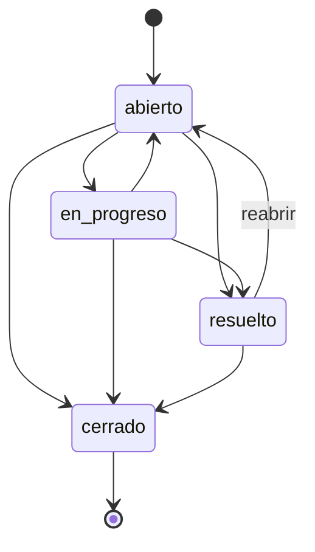

# centribal-admision

Sistema de **gestión de solicitudes de soporte** (tickets) hecho con **Django 5.2 LTS**. Tiene tres caras sobre los mismos datos:

- una **API REST** con Django REST Framework, para que la usen otros programas;
- una **interfaz web** con templates de Django, para clientes y agentes;
- el **panel de administración** de Django.

El repositorio incluye además una ruta de aprendizaje de Python (`docs/` + `ejercicios/`). Todo corre en **Docker**: no hace falta instalar Python en el ordenador.

---

## Índice

1. [Caso de uso](#1-caso-de-uso)
2. [Arranque rápido](#2-arranque-rápido)
3. [Entorno Docker](#3-entorno-docker)
4. [Estructura del repositorio](#4-estructura-del-repositorio)
5. [Modelo del dominio y reglas](#5-modelo-del-dominio-y-reglas)
6. [Referencia de la API](#6-referencia-de-la-api)
7. [Interfaz web](#7-interfaz-web)
8. [Autenticación y agentes](#8-autenticación-y-agentes)
9. [Cómo está organizado el código Django](#9-cómo-está-organizado-el-código-django)
10. [Tests](#10-tests)
11. [Depuración](#11-depuración)
12. [Ruta de aprendizaje: docs y ejercicios](#12-ruta-de-aprendizaje-docs-y-ejercicios)
13. [Configuración (variables de entorno)](#13-configuración-variables-de-entorno)
14. [Decisiones de diseño](#14-decisiones-de-diseño)
15. [Limitaciones y siguientes pasos](#15-limitaciones-y-siguientes-pasos)
16. [Problemas frecuentes](#16-problemas-frecuentes)

---

## 1. Caso de uso

Un **cliente** abre una solicitud con **asunto**, **descripción** y **prioridad**. La solicitud nace en estado `abierto` y sin agente.

Los **agentes** (personal interno) pueden:

- listar y filtrar solicitudes;
- **asignarlas** a un agente (o quitar la asignación);
- **cambiar su estado** siguiendo un flujo con reglas;
- añadir **comentarios internos**;
- consultar el **historial de cambios**, que se registra automáticamente en cada cambio de estado o de asignación.

---

## 2. Arranque rápido

Requisitos: **Docker** con **Docker Compose v2**. Nada más.

```bash
docker compose up -d                                         # construye, migra y arranca en :8000
docker compose exec web python manage.py crear_agentes       # crea los agentes ana y luis + sus tokens
```

| URL | Qué es |
|---|---|
| http://localhost:8000/nuevo/ | Formulario público para crear una solicitud |
| http://localhost:8000/ | Interfaz de agentes (usuario `ana` o `luis`, contraseña `agente-dev-123`) |
| http://localhost:8000/api/ | API navegable de DRF (los tickets en `/api/tickets/`) |
| http://localhost:8000/admin/ | Panel de administración (requiere superusuario, ver [§9](#9-cómo-está-organizado-el-código-django)) |

Para parar: `docker compose down`.

> La contraseña `agente-dev-123` solo existe para el entorno local. Está en
> [`crear_agentes.py`](soporte/management/commands/crear_agentes.py).

---

## 3. Entorno Docker

- **Imagen**: `python:3.13-slim` (Debian slim oficial). Python 3.13 porque Django 5.2 LTS la soporta oficialmente.
- **Volumen**: el proyecto se monta en `/app` dentro del contenedor. Los cambios en el código se ven al instante y `runserver` se recarga solo.
- **Dependencias** ([`requirements.txt`](requirements.txt)): `Django`, `djangorestframework`, `django-filter`, `debugpy`, `mypy`.

### Servicios ([`compose.yaml`](compose.yaml))

| Servicio | Puerto | Para qué |
|---|---|---|
| `web` | 8000 | La aplicación: `migrate` + `runserver`. Arranca con `docker compose up` |
| `shell` | 5678 (debugpy) | Terminal para ejercicios, tests y depuración. Solo se usa con `docker compose run` |

### Comandos útiles

```bash
docker compose up -d                                   # arrancar en segundo plano
docker compose logs -f web                             # ver logs
docker compose exec web python manage.py shell         # consola de Django con los modelos cargados
docker compose run --rm shell                          # terminal dentro de un contenedor nuevo
docker compose run --rm --service-ports shell          # igual, publicando el 5678 para VS Code
docker compose build                                   # reconstruir la imagen (tras cambiar requirements.txt)
docker compose down                                    # parar y borrar contenedores
docker compose down --rmi local                        # además borra la imagen: empezar de cero
```

---

## 4. Estructura del repositorio

```
centribal-admision/
├── manage.py                      # puerta de entrada de los comandos de Django
├── config/                        # el PROYECTO Django
│   ├── settings.py                # configuración global
│   ├── urls.py                    # rutas raíz
│   └── wsgi.py, asgi.py           # puntos de entrada para servidores
├── soporte/                       # la APP de tickets
│   ├── models.py                  # Ticket, Comentario, Historial + reglas de negocio
│   ├── serializers.py, views.py, urls.py          # API (DRF)
│   ├── forms.py, views_ui.py, urls_ui.py          # interfaz web
│   ├── templates/                 # HTML (soporte/*.html, registration/login.html)
│   ├── admin.py                   # panel de administración
│   ├── management/commands/crear_agentes.py
│   ├── migrations/                # historial del esquema de la BD
│   └── tests/                     # test_api.py, test_ui.py
├── docs/                          # teoría de Python y de Django
├── ejercicios/                    # un script por tema
├── Dockerfile, compose.yaml, requirements.txt
├── .vscode/launch.json            # "Attach to Docker" (debugpy, puerto 5678)
└── PLAN.md                        # plan original de trabajo
```

---

## 5. Modelo del dominio y reglas

### Entidades

**Ticket**

| Campo | Tipo | Notas |
|---|---|---|
| `id` | entero | autogenerado |
| `asunto` | texto (máx. 200) | obligatorio, no puede estar vacío |
| `descripcion` | texto | obligatorio |
| `prioridad` | `baja` · `media` · `alta` · `critica` | por defecto `media` |
| `estado` | `abierto` · `en_progreso` · `resuelto` · `cerrado` | nace `abierto`; solo cambia por su acción |
| `agente` | usuario agente o `null` | solo cambia por su acción |
| `creado`, `actualizado` | fecha/hora (UTC) | automáticos |

**Comentario**: `ticket`, `autor` (agente), `texto`, `es_interno` (siempre `true`) y `fecha`.

**Historial**: `ticket`, `campo` (`estado` o `agente`), `valor_anterior`, `valor_nuevo`, `autor` y `fecha`.

### Flujo de estados



### Reglas de negocio

1. Solo se permiten las transiciones del diagrama. **Un ticket `cerrado` no se reabre.**
2. No se puede "cambiar" al mismo estado en el que ya está.
3. Un ticket `cerrado` **no se puede reasignar**.
4. No se puede asignar al agente que ya tiene (tampoco "desasignar" uno que no tiene agente).
5. Solo se puede asignar a **agentes** (usuarios con `is_staff`).
6. Cada cambio de estado o de asignación crea una entrada de **historial en la misma transacción**: o se guardan los dos, o ninguno.
7. Crear un ticket ignora cualquier `estado` o `agente` que mande el cliente.

Las reglas están en [`soporte/models.py`](soporte/models.py) (`validar_estado`, `validar_asignacion`, `cambiar_estado`, `asignar`). Las usan tanto la API como la interfaz web.

---

## 6. Referencia de la API

| Método | Ruta | Acción | Acceso |
|---|---|---|---|
| `POST` | `/api/tickets/` | Crear solicitud | Público |
| `GET` | `/api/tickets/` | Listar | Agente |
| `GET` | `/api/tickets/{id}/` | Detalle | Agente |
| `PATCH` | `/api/tickets/{id}/estado/` | Cambiar estado (+ historial) | Agente |
| `PATCH` | `/api/tickets/{id}/asignar/` | Asignar o desasignar (+ historial) | Agente |
| `POST` | `/api/tickets/{id}/comentarios/` | Añadir comentario interno | Agente |
| `GET` | `/api/tickets/{id}/comentarios/` | Listar comentarios | Agente |
| `GET` | `/api/tickets/{id}/historial/` | Ver historial | Agente |
| `POST` | `/api/token/` | Obtener token con `username` y `password` | Público |

**Filtros del listado**: `?estado=abierto`, `?prioridad=alta`, `?agente__username=luis`. Se pueden combinar.

### Ejemplos

```bash
B=http://localhost:8000/api
J="Content-Type: application/json"
T="Authorization: Token <token de ana>"     # lo imprime: manage.py crear_agentes
```

**Crear una solicitud** (público) → `201 Created`

```bash
curl -X POST $B/tickets/ -H "$J" \
  -d '{"asunto": "No puedo entrar", "descripcion": "Error 500 al hacer login", "prioridad": "alta"}'
```

```json
{
  "id": 1,
  "asunto": "No puedo entrar",
  "descripcion": "Error 500 al hacer login",
  "prioridad": "alta",
  "estado": "abierto",
  "agente": null,
  "creado": "2026-10-02T20:26:11.413651Z",
  "actualizado": "2026-10-02T20:26:11.413674Z"
}
```

**Listar con filtros** → `200 OK`

```bash
curl "$B/tickets/?estado=abierto&prioridad=alta" -H "$T"
```

**Asignar** (`null` para desasignar) → `200 OK` con el ticket actualizado

```bash
curl -X PATCH $B/tickets/1/asignar/ -H "$T" -H "$J" -d '{"agente": "luis"}'
```

**Cambiar estado** → `200 OK` con el ticket actualizado

```bash
curl -X PATCH $B/tickets/1/estado/ -H "$T" -H "$J" -d '{"estado": "en_progreso"}'
```

**Comentar** → `201 Created`

```bash
curl -X POST $B/tickets/1/comentarios/ -H "$T" -H "$J" -d '{"texto": "Reproducido en staging"}'
```

```json
{"id": 1, "autor": "ana", "texto": "Reproducido en staging", "es_interno": true, "fecha": "2026-10-02T20:26:11.467109Z"}
```

**Historial** → `200 OK`

```bash
curl $B/tickets/1/historial/ -H "$T"
```

```json
[
  {"id": 1, "campo": "agente", "valor_anterior": null,      "valor_nuevo": "luis",        "autor": "ana", "fecha": "..."},
  {"id": 2, "campo": "estado", "valor_anterior": "abierto", "valor_nuevo": "en_progreso", "autor": "ana", "fecha": "..."}
]
```

### Códigos de respuesta y errores

| Código | Cuándo |
|---|---|
| `200` / `201` | Correcto / creado |
| `400` | Datos inválidos o regla de negocio incumplida (transición no permitida, ticket cerrado…) |
| `401` | No hay credenciales |
| `403` | Hay credenciales, pero el usuario no es agente |
| `404` | El ticket no existe |
| `405` | Método no permitido (p. ej. `DELETE /api/tickets/1/`) |

Los errores vienen en el formato de DRF:

```jsonc
{"estado": ["\"pausado\" no es una elección válida."]}                 // error de un campo
{"non_field_errors": ["El ticket ya está asignado a ese agente."]}     // regla general
{"detail": "Las credenciales de autenticación no se proveyeron."}     // autenticación / permisos
```

---

## 7. Interfaz web

Está hecha con **templates de Django** (HTML generado en el servidor), sin JavaScript ni librerías externas, con tema claro/oscuro automático.

| Ruta | Página | Acceso |
|---|---|---|
| `/nuevo/` | Formulario para abrir una solicitud | Público |
| `/` | Lista con filtros por estado, prioridad, "asignados a mí" y "sin asignar" | Agente |
| `/tickets/<id>/` | Detalle: cambio de estado (solo muestra transiciones válidas), asignación, comentarios e historial | Agente |
| `/cuentas/login/` | Login de agentes | Público |

Las acciones siguen el patrón **POST → redirect → GET**: si recargas la página, la acción no se repite. Si un formulario tiene errores, la página se vuelve a pintar con el mensaje.

### Interfaz web y API comparten el modelo

```
   Navegador (persona)                   App móvil / frontend JS / otro sistema
          │                                            │
   /     → views_ui.py + forms.py             /api/ → views.py + serializers.py (DRF)
          devuelve HTML                                devuelve JSON
          └───────────────────────┬────────────────────┘
               models.py: validar_estado(), validar_asignacion(), cambiar_estado(), asignar()
                                  │
                            base de datos
```

- La **interfaz web** es para personas. La **API** es para programas: un widget de chat que abre tickets, un sistema de monitorización, una app móvil, o un frontend futuro en React.
- Las reglas se escriben **una sola vez** en el modelo. Un cambio hecho por la interfaz web aparece en la API y al revés.

---

## 8. Autenticación y agentes

Un **agente** es un `User` de Django con `is_staff=True`.

| Dónde | Cómo |
|---|---|
| API | `Authorization: Token <clave>`, o la sesión del navegador (API navegable) |
| Interfaz web | Login con usuario y contraseña en `/cuentas/login/` |
| Admin | Login en `/admin/` (para gestionar modelos hace falta un superusuario) |

```bash
docker compose exec web python manage.py crear_agentes                       # imprime los tokens
curl -X POST http://localhost:8000/api/token/ -d 'username=ana&password=agente-dev-123'   # {"token": "..."}
```

Crear un ticket es lo único que no exige autenticación.

---

## 9. Cómo está organizado el código Django

| Pieza | Archivo | Papel |
|---|---|---|
| Settings | `config/settings.py` | Apps instaladas, BD, middleware, configuración de DRF |
| Rutas | `config/urls.py` → `soporte/urls_ui.py` (web, en `/`) y `soporte/urls.py` (API, en `/api/`) | URL → vista |
| Modelos | `soporte/models.py` | Tablas (vía migraciones) y reglas de negocio |
| Serializers | `soporte/serializers.py` | JSON ↔ modelo, validación de la API |
| ViewSet | `soporte/views.py` | `TicketViewSet` con `@action` para `estado`, `asignar`, `comentarios` e `historial` |
| Forms + vistas web | `soporte/forms.py`, `views_ui.py`, `templates/` | Interfaz HTML |
| Admin | `soporte/admin.py` | Tickets con comentarios e historial en línea; estado y agente en solo lectura |
| Comando | `soporte/management/commands/crear_agentes.py` | Agentes de prueba + tokens |

Para seguir el recorrido completo de una petición por estos archivos, ver [docs/06-django-por-dentro.md](docs/06-django-por-dentro.md).

### Tareas habituales

```bash
docker compose exec web python manage.py crear_agentes      # agentes de prueba
docker compose exec web python manage.py createsuperuser    # usuario para /admin/
docker compose exec web python manage.py makemigrations     # tras cambiar models.py
docker compose exec web python manage.py migrate            # aplicar migraciones
docker compose exec web python manage.py showmigrations     # ver migraciones aplicadas y pendientes
docker compose exec web python manage.py shell              # consola con los modelos cargados
```

La base de datos es `db.sqlite3`, en la raíz del proyecto (git la ignora).

---

## 10. Tests

```bash
# Los 20 tests (12 de API + 8 de interfaz web)
docker compose run --rm shell python manage.py test -v 2

# Un archivo o un solo test
docker compose run --rm shell python manage.py test soporte.tests.test_ui
docker compose run --rm shell python manage.py test soporte.tests.test_api.TicketApiTest.test_flujo_completo
```

Django crea una base de datos de test aparte, así que tus datos no se tocan. Qué se cubre: valores por defecto y validación al crear, permisos (401/403 en la API, redirección al login en la web), filtros, el flujo completo (asignar → estado → comentar → historial), transiciones prohibidas sin efectos secundarios, desasignar y métodos no permitidos.

---

## 11. Depuración

Resumen de [`docs/05-debug.md`](docs/05-debug.md):

- **`breakpoint()` + pdb**: pon `breakpoint()` en el código y ejecútalo con una terminal interactiva (`docker compose run --rm shell ...`, sin `-T`). Comandos básicos: `n`, `s`, `c`, `p variable`, `q`.
- **VS Code**: para el servicio web y arranca el servidor esperando al debugger. Luego conecta con **"Attach to Docker"** ([`.vscode/launch.json`](.vscode/launch.json)):

  ```bash
  docker compose stop web
  docker compose run --rm --service-ports -p 8000:8000 shell \
    python -Xfrozen_modules=off -m debugpy --listen 0.0.0.0:5678 --wait-for-client \
    manage.py runserver 0.0.0.0:8000 --noreload
  ```

---

## 12. Ruta de aprendizaje: docs y ejercicios

| # | Tema | Teoría | Práctica |
|---|---|---|---|
| 1 | Historia y filosofía de Python | [01-historia.md](docs/01-historia.md) | — |
| 2 | ¿Interpretado o compilado? Bytecode, PVM, `__pycache__` | [02-interpretado-o-compilado.md](docs/02-interpretado-o-compilado.md) | `02_bytecode.py` |
| 3 | Tipado dinámico y fuerte, duck typing, type hints, mypy | [03-tipado.md](docs/03-tipado.md) | `03_tipado.py` |
| 4 | `if`, `match`, bucles, excepciones, comprehensions | [04-estructuras-de-control.md](docs/04-estructuras-de-control.md) | `04_control.py` |
| 5 | Debug: logging, pdb, debugpy + VS Code | [05-debug.md](docs/05-debug.md) | `05_debug.py` (con un bug para encontrar) |
| 6 | Django por dentro: petición, rutas, ORM, validación, patrones | [06-django-por-dentro.md](docs/06-django-por-dentro.md) | `manage.py shell` |

```bash
docker compose run --rm shell python ejercicios/02_bytecode.py
docker compose run --rm shell mypy ejercicios/03_tipado.py
```

---

## 13. Configuración (variables de entorno)

| Variable | Por defecto | Para qué |
|---|---|---|
| `DJANGO_SECRET_KEY` | valor inseguro de desarrollo | Clave criptográfica (obligatorio cambiarla en producción) |
| `DJANGO_DEBUG` | `1` | `0` desactiva el modo debug |
| `DJANGO_ALLOWED_HOSTS` | `*` si hay debug | Dominios permitidos, separados por comas, cuando `DJANGO_DEBUG=0` |
| `DJANGO_DB_PATH` | `db.sqlite3` | Ruta de la base de datos |

---

## 14. Decisiones de diseño

- **Docker en vez de instalar Python**: el sistema no se toca y cualquiera reproduce el mismo entorno.
- **Reglas de negocio en el modelo**: la interfaz web (forms) y la API (serializers) llaman a las mismas validaciones, así que no se duplican.
- **Estado y agente no se editan directamente**: solo por sus acciones, que validan y dejan historial. Por eso son de solo lectura en el serializer y en el admin.
- **Historial en la misma transacción que el cambio**: nunca hay un cambio sin rastro ni un rastro sin cambio.
- **Agente = `User` con `is_staff`**: reutiliza usuarios, contraseñas, permisos y admin en lugar de crear un modelo propio.
- **Token primero en la autenticación de DRF**: así un anónimo recibe `401` (con cabecera `WWW-Authenticate`) y no `403`.
- **SQLite**: sin servidor de base de datos aparte. Pasar a PostgreSQL solo exige cambiar `DATABASES`.

---

## 15. Limitaciones y siguientes pasos

- Se usa el `User` de Django tal cual. Lo recomendable es un modelo de usuario propio (`AbstractUser`) desde el principio.
- No hay paginación en la API (en DRF se activa con `DEFAULT_PAGINATION_CLASS`).
- El cliente no tiene cuenta: no puede consultar sus solicitudes después de crearlas.
- No hay notificaciones (email al asignar, etc.) ni tareas en segundo plano.
- `runserver` es solo para desarrollo. En producción haría falta gunicorn, PostgreSQL, `DJANGO_DEBUG=0` y servir los estáticos (`collectstatic` + WhiteNoise).
- Posibles mejoras: uv + Ruff + mypy con django-stubs, CI, documentación OpenAPI (`drf-spectacular`), HTMX en la interfaz web.

---

## 16. Problemas frecuentes

| Síntoma | Solución |
|---|---|
| `port is already allocated` | Otro proceso usa el 8000 o el 5678. Páralo, o cambia el puerto de la izquierda en `compose.yaml` (`"9000:8000"`) |
| `401` en la API | Falta la cabecera `Authorization: Token ...` |
| `403` en la API | El usuario existe pero no es agente (`is_staff`) |
| La web manda al login | Entra con un agente (`ana` / `luis`) |
| `no such table` | Faltan migraciones: `docker compose exec web python manage.py migrate` (el servicio `web` las aplica al arrancar) |
| `/admin/` dice que no tienes permisos | Entra con un superusuario (`createsuperuser`) |
| Empezar con datos limpios | `docker compose down`, borra `db.sqlite3` y vuelve a `docker compose up -d` |
| Cambié `requirements.txt` y no se nota | `docker compose build` |
| pdb no responde | Ejecuta sin `-T`: necesita una terminal interactiva |
